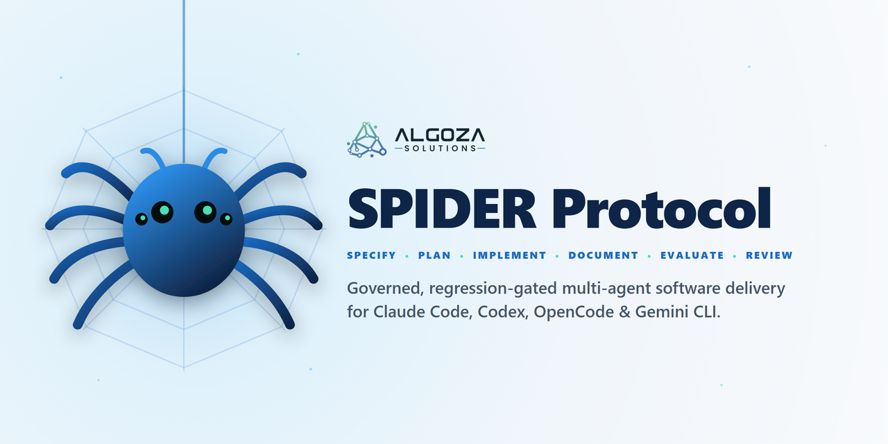
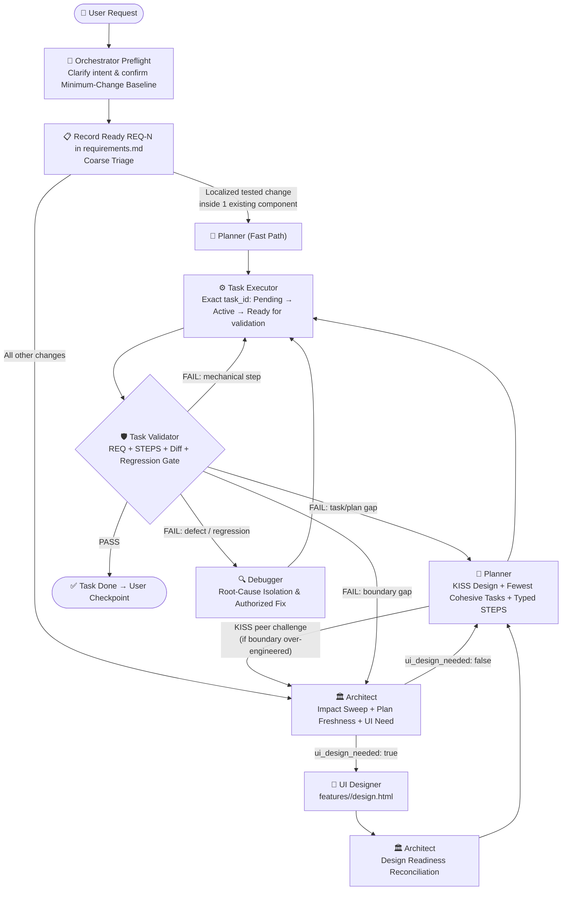

<div align="center">

<picture>
  <source media="(prefers-color-scheme: dark)" srcset="docs/assets/spider-banner-dark.png">
  <source media="(prefers-color-scheme: light)" srcset="docs/assets/spider-banner-light.png">
  
</picture>

<br>

[](https://github.com/Algoza-Solutions/spider-protocol/releases)
[](LICENSE)
[](https://github.com/Algoza-Solutions/spider-protocol/actions/workflows/verify.yml)
[](#quickstart)
[](https://algozasolutions.com/)

*Stop AI coding agents from over-engineering, losing architectural context, or breaking working features in endless fix loops.*

[Why SPIDER?](#why-spider) • [How It Works](#how-it-works) • [Quickstart](#quickstart) • [The 8 Agent Roles](#the-8-agent-roles) • [Architecture & Docs](docs/architecture.md)

</div>

---

## Why SPIDER?

Single-prompt coding agents and vibe-coding tools excel at version one—and routinely collapse on iteration fifteen:

1. **Silent Over-Engineering:** Ask for a small feature and the agent invents three new wrapper classes, a service layer, and an unrequested dependency.
2. **Context Amnesia:** Architectural decisions live in transient chat history. Two sessions later, a new agent session violates invariants from last week.
3. **Self-Grading Homework:** The same agent that wrote the code declares *"All done!"* after skipping edge cases or weakening tests.
4. **Destructive Fix Loops:** When a bug appears, the agent patches symptoms blindly, introducing regressions in previously working modules.

**SPIDER** turns your repository into a governed engineering organization. Work is split across **8 specialized role contracts**, coordinated through **shared, append-only Markdown/YAML state files**, and gated by an **independent validator** that audits git diffs, upstream architecture contracts, and full-suite regression tests before any task can be marked `Done`.

### The SPIDER Model: 6 Phases, 8 Legs, 1 Web

SPIDER combines **6 engineering phases (`S.P.I.D.E.R.`)**, **8 specialist roles ("8 legs")** so no single agent grades its own homework, and **1 web-structured repository memory** ([`docs/terminology.md`](docs/terminology.md)):

| Letter | Phase | Role Owner(s) | Repository Artifact(s) |
| :---: | :--- | :--- | :--- |
| **S** | **Specify** | [`spider-orchestrator`](skills/spider-orchestrator/SKILL.md), [`architect`](skills/architect/SKILL.md), [`ui-designer`](skills/ui-designer/SKILL.md) | Preflight minimum-change baseline, `requirements.md` (`REQ-N`), `blast-radius-summary.md`, `build-plan.md`, `design.html` |
| **P** | **Plan** | [`planner`](skills/planner/SKILL.md) | Peer KISS challenge, `task-index.yaml`, and `features/<slug>/tasks/tN-*.md` with typed resumable `STEPS` |
| **I** | **Implement** | [`task-executor`](skills/task-executor/SKILL.md) | Code changes strictly inside authorized `STEPS` (`Pending → Active → Ready for validation`) |
| **D** | **Document** | All writers + [`doc-cleanup`](skills/doc-cleanup/SKILL.md) | Newest-first append-only `decisions.md`, living `architecture.md`, task `## LOG` / `## DEBUG LOG`, and tombstoned compaction |
| **E** | **Evaluate** | [`task-validator`](skills/task-validator/SKILL.md), [`debugger`](skills/debugger/SKILL.md) | `validation/tN-validation.json` (contract chain + diff + regression suite gate) and `defects/bug-req-N-*.md` |
| **R** | **Review** | [`spider-orchestrator`](skills/spider-orchestrator/SKILL.md) + **Human** | Closed repair-loop routing, **Decision Checkpoints**, and **Iteration Checkpoints** before `REQ` closure |

- **The Hub (`project.md` & `requirements.md`):** Center of the web where agents **Sense** current project state before acting.
- **Radials (`features/<slug>/tasks/tN-*.md`):** Task spokes branching from the Hub, with **Spirals** (`## LOG`) tracking each iteration.
- **The Dragline (`decisions.md` + Git history):** The safety silk thread trailed behind every change so the team can **Retreat** or **Repair** cleanly without destructive fix loops.

---

## What Makes SPIDER Different?

First-generation Spec-Driven Development (SDD) tools proved that written specs beat unstructured "vibe coding," but introduced new failure modes in real-world brownfield repositories: **heavy ceremony on small fixes**, **blindly trusting AI-generated architectural bloat**, and **letting execution loops grade their own homework**.

**SPIDER is a Generation-2 SDD protocol** built to solve those exact trade-offs:

| Capability | Gen-1 Spec / Prompt Packs | 🕷️ SPIDER Protocol (Gen-2 SDD) |
| :--- | :--- | :--- |
| **Scope & Bloat Control** | Agents freely invent helpers, layers, and abstractions | **Minimum-Change Baseline:** Preflight establishes the smallest direct change; any new file, class, or dependency requires explicit user approval |
| **Architecture vs. KISS** | Planner blindly implements whatever Architect writes | **Peer KISS Challenge:** Planner is a peer Tech Lead that halts planning and challenges over-engineered Architect boundaries |
| **Execution Discipline** | Free-form task checklists | **Typed Resumable `STEPS`:** Exact `[create]`, `[modify]`, `[delete]`, `[reference]` (read-only), and `[run]` contracts; only **one** task can be `Active` at a time |
| **Quality Gate** | Executor marks its own task complete | **Independent `task-validator`:** Executor can only mark `Ready for validation`. Validator audits the full contract chain, git diff, and regression suite before marking `Done` |
| **Bug Handling** | Ad-hoc patching mid-task | **Dedicated `debugger` Role:** Hypothesis-driven root-cause isolation with durable defect records (`features/<slug>/defects/`) |
| **Contract Integrity** | Unverified markdown prompts | **SHA-256 Manifest Verification:** `verify_specialist_skills.py` cryptographically verifies all specialist contracts before role handoffs |

### Where SPIDER Fits in the Ecosystem

| Tool | Sweet Spot | Trade-off | How SPIDER Differs |
| :--- | :--- | :--- | :--- |
| **BMAD-METHOD** | Agile persona simulation (PM, Architect, SM, Dev, QA/TEA) + Quick Flow | SM/Dev agents rarely challenge Architect bloat; full-track PRD/story ceremony is heavy | **Preflight Minimum-Change Baseline** + **Planner ↔ Architect Peer KISS Challenge** block unapproved abstractions; **SHA-256 verified** skill bundle |
| **GitHub Spec Kit** | Slash-command pipeline (`/speckit.specify → plan → tasks → analyze`) | Single-agent command sequence; `/speckit.analyze` checks pre-code markdown consistency | **8 separated role contracts**, dedicated **`debugger` role** (`defects/`), and a **post-code `task-validator`** auditing git diffs against typed `STEPS` + live test suites |
| **Superpowers (`obra`)** | Composable TDD, debugging, and subagent code-review skills | Spawns fresh subagents per task; tracks state per plan rather than a permanent repo-wide ledger | **In-thread role transitions** (preserving prompt cache prefixes) + permanent cross-feature **`REQ → Decision → Task → Validation` ledger** + Peer KISS Challenge |
| **OpenSpec / GSD** | Brownfield delta specs (`/opsx:verify`) & fast execution loops | Lighter on role-separated governance and upstream anti-bloat challenges | Combines a low-ceremony **Fast Path** with **two-tier anti-bloat governance** (Minimum-Change Baseline + KISS Challenge) and hard **`task-validator` `Done` gating** |

---

## How It Works



---

## Quickstart

SPIDER requires **Python 3.10+** (standard library only, zero external packages) for its installer and SHA-256 bundle verifier.

### 1. Clone the repository

```bash
git clone https://github.com/Algoza-Solutions/spider-protocol.git
cd spider-protocol
```

### 2. Install skills / agents into your coding environment

Install into **Codex** (`~/.codex/skills`), **Claude Code** (`~/.claude/agents`), **OpenCode** (`~/.config/opencode/skills`), **Gemini / Antigravity** (`~/.gemini/config/skills`), or all at once:

```bash
# Install into all supported environments (Codex, OpenCode, Gemini/Antigravity, Claude Code)
python scripts/install.py --target all

# Or install into a specific environment:
python scripts/install.py --target codex
python scripts/install.py --target claude
python scripts/install.py --target opencode
python scripts/install.py --target gemini
```

### 3. Initialize SPIDER in your project repository

Bootstrap the lightweight Markdown/YAML state stores (`project.md`, `requirements.md`, `decisions.md`, `task-index.yaml`, `architecture/`, `features/`) in any existing or new repository:

```bash
python scripts/install.py --init-project /path/to/your/project
```

### 4. Start building with the Orchestrator

Open your project in your coding agent and invoke **`spider-orchestrator`** (or `@orchestrator` in Claude Code) with your feature request or bug report:

> *"Use spider-orchestrator: Add rate limiting to the `/api/login` endpoint using our existing Redis client."*

The orchestrator will:
1. Inspect your codebase read-only and propose the **minimum direct baseline** (disclosing if any new file or structure is needed).
2. Wait for your confirmation before recording `REQ-1` in `requirements.md`.
3. Route through the fast path (or Architect → Planner for cross-cutting changes), execute the exact task, and run `task-validator` to verify the diff and test suite.

---

## The 8 Agent Roles

| Role (`skills/` & `agents/`) | Responsibility |
| :--- | :--- |
| **[`spider-orchestrator`](skills/spider-orchestrator/SKILL.md)** (`orchestrator.md`) | Owns conversational preflight discovery, minimum-baseline confirmation, `REQ-N` lifecycle, coarse triage, exact task pointer routing, repair loops, and user checkpoints. |
| **[`architect`](skills/architect/SKILL.md)** (`architect.md`) | Evaluates architectural impact, plan freshness, and UI-design need independently; owns durable boundary decisions (`decisions.md`), `build-plan.md`, and `blast-radius-summary.md`. |
| **[`ui-designer`](skills/ui-designer/SKILL.md)** (`ui-designer.md`) | Produces self-contained, accessible UX/UI specifications (`features/<slug>/design.html`) covering user flows, screen states, and interaction contracts before task planning. |
| **[`planner`](skills/planner/SKILL.md)** (`planner.md`) | Peer Tech Lead under KISS: challenges unnecessary upstream complexity, creates the fewest cohesive tasks, and writes typed resumable `STEPS` in `features/<slug>/tasks/tN-*.md`. |
| **[`task-executor`](skills/task-executor/SKILL.md)** (`task-executor.md`) | Implements one exact dispatched task inside its authorized shape (`Pending → Active → Ready for validation`). Never marks its own work `Done`. |
| **[`task-validator`](skills/task-validator/SKILL.md)** (`task-validator.md`) | Audits the full upstream contract chain, git diff, and project regression test suite; writes `features/<slug>/validation/tN-validation.json`; alone marks delivery tasks `Done`. |
| **[`debugger`](skills/debugger/SKILL.md)** (`debugger.md`) | Investigates post-validation failures or user-reported bugs via hypothesis testing; writes durable defect reports (`features/<slug>/defects/`) and applies only localized authorized fixes. |
| **[`doc-cleanup`](skills/doc-cleanup/SKILL.md)** (`doc-cleanup.md`) | Compacts completed task files and stale artifacts while preserving `REQ` acceptance evidence, monotonic `task-index.yaml` tombstones, and immutable decisions. |

---

## Repository State Stores (In Your Project)

SPIDER keeps all project memory in human-readable files committed alongside your code—never trapped in proprietary cloud state or ephemeral chat logs:

```text
your-project/
├── project.md                              # Hub: project overview, current state, and active/completed task table
├── requirements.md                         # Orchestrator-owned REQ/AC registry and validation evidence trail
├── decisions.md                            # Append-only architectural decision log (D1, D2, ...)
├── task-index.yaml                         # Machine-readable task state, REQ trace, and monotonic high-water mark
├── architecture/
│   ├── architecture.md                     # Living system architecture reference
│   └── flows.md                            # Key runtime and protocol flows
└── features/
    └── <feature-slug>/
        ├── requirements.md                 # Detailed requirement contract + confirmed minimum baseline
        ├── blast-radius-summary.md         # Architect impact sweep & triage metadata
        ├── build-plan.md                   # Component boundary & integration plan (when architecture changes)
        ├── design.html                     # UI/UX specification (when ui_design_needed is true)
        ├── tasks/
        │   └── t1-<slug>.md                # Planner-authored task contract with GOAL, typed STEPS, NOW, and LOG
        ├── validation/
        │   └── t1-validation.json          # Structured validator audit report
        └── defects/
            └── bug-req-N-<slug>.md         # Debugger root-cause diagnosis report
```

---

## Verifying Bundle Integrity

`spider-orchestrator` includes a zero-dependency cryptographic verifier that checks manifest version, role directory structure, frontmatter, and line-ending-normalized SHA-256 digests across all 7 specialist skills:

```bash
# Verify the repository skill bundle
python skills/spider-orchestrator/scripts/verify_specialist_skills.py --codex-home .

# Run the 22-test behavioral regression suite
python -m unittest discover -s skills/spider-orchestrator/scripts -v
```

---

## Documentation

- [**Protocol Architecture (`docs/architecture.md`)**](docs/architecture.md) — System layers, role boundaries, and core invariants.
- [**Routing & Repair Flows (`docs/flows.md`)**](docs/flows.md) — Fast path vs. deep triage, closed repair loops, taskless defect intake, and Done revalidation audits.
- [**Evolving Spider Terminology (`docs/terminology.md`)**](docs/terminology.md) — Mental model mapping protocol concepts (`Hub`, `Radials`, `Dragline`, `Sense → Spin → Wrap → Anchor`).
- [**Contributing Guide (`CONTRIBUTING.md`)**](CONTRIBUTING.md) — How to update role contracts and regenerate manifest hashes.

---

## Built in Production by Algoza Solutions

SPIDER was created and battle-tested by [**Algoza Solutions**](https://algozasolutions.com/) to run disciplined, regression-checked AI software engineering across production codebases.

> **Have an AI-built or vibe-coded app (Lovable, Bolt, Replit, Cursor, v0) that keeps breaking as you add features, or want managed SPIDER engineering for your project?**
> Drop us an email at [**info@algozasolutions.com**](mailto:info@algozasolutions.com) — we harden fragile codebases, fix security gaps, and manage ongoing development with SPIDER's regression-gated workflow so new changes never break existing features.

---

## License

Released under the [MIT License](LICENSE). Copyright © 2026 [Algoza Solutions (OPC) Private Limited](https://algozasolutions.com/).
